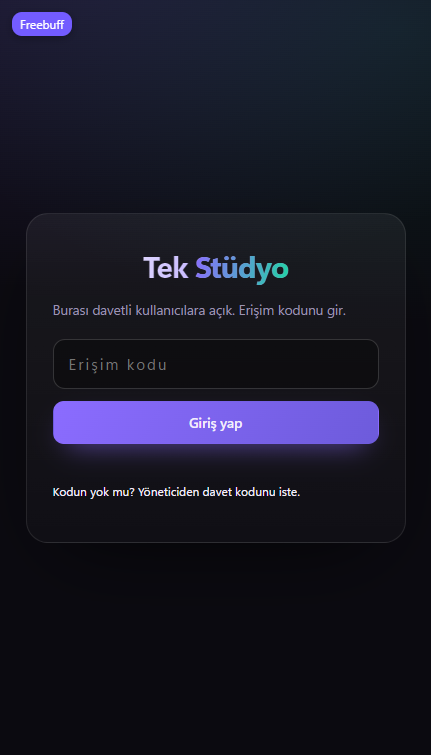
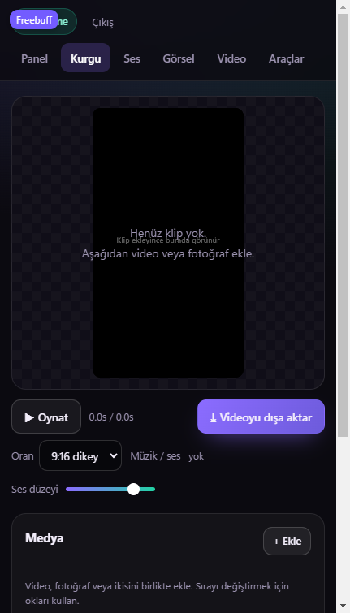
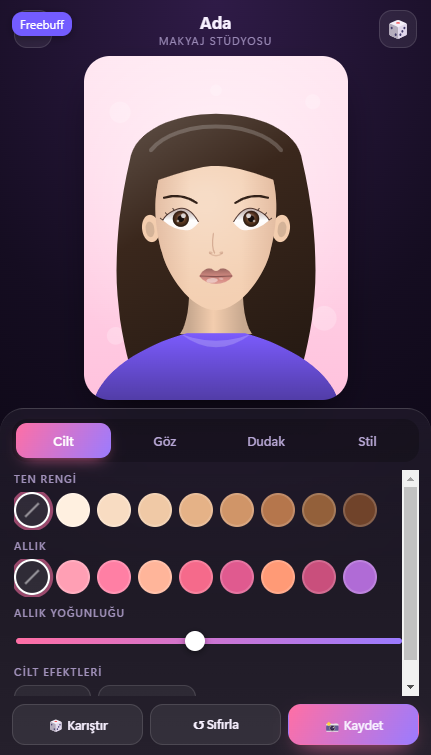

# Tek Stüdyo + Makyaj Stüdyosu

Bu klasörde iki ayrı uygulama var:

| Yol | Uygulama | Ne yapar |
| --- | --- | --- |
| `/` (kök) | **Tek Stüdyo** | Girişli video kurgu, seslendirme, görsel üretimi ve AI araç panosu |
| `/makyaj/` | **Makyaj Stüdyosu** | 12 karakterli makyaj oyunu (tek dosya, kurulum yok) |

## Ekran görüntüleri

| Giriş kapısı | Kurgu | Makyaj oyunu |
| --- | --- | --- |
|  |  |  |

---

## 1. Tek Stüdyo

### Modüller

- **Kurgu** — video/fotoğraf yükle, sırala, klip kes (başlangıç-bitiş), yazı ekle, müzik/seslendirme
  yerleştir; 9:16 / 1:1 / 16:9 oranlarında gerçek zamanlı dışa aktarım (`.webm`).
- **Seslendirme** — metni Türkçe sese çevirir, MP3 indirir veya doğrudan kurguya ses olarak ekler.
  Ayrıca tarayıcının kendi konuşma motoruyla ücretsiz önizleme.
- **Görsel** — prompt + stil ile görsel üretimi, geçmiş, indirme ve tek tıkla kurguya ekleme.
- **Video** — fotoğraflardan hareketli video (yakınlaş/kaydır) üretir; ücretsiz video araçlarını listeler.
- **Araçlar** — 18 ücretsiz AI aracı tek panoda: promptu kopyala, aracı yeni sekmede aç.

### Erişim (sadece davetli kullanıcılar)

Erişim, sunucu tarafındaki Worker kapısıyla kontrol edilir:

- `INVITE_CODES` = `kod=İsim` çiftleri, virgülle: `ORNEK1=Ada, ORNEK2=Mert`
- `SESSION_SECRET` = uzun rastgele bir metin
- Giriş kodu doğruysa HMAC ile imzalı, 7 gün geçerli `HttpOnly` çerez verilir.
- Oturum yoksa uygulama HTML'i değil, yalnızca giriş sayfası sunulur.

Bu iki değer **Sites → Secrets** içine girilir; kodda saklanmaz.

### Yerel geliştirme

```bash
powershell -ExecutionPolicy Bypass -File serve.ps1
```

`http://localhost:8080/` adresinde açılır. Worker olmadığı için oturum katmanı "geliştirme modu"na
düşer (kapı devre dışı) ve AI çağrıları doğrudan ücretsiz uç noktalara gider.

**Bilinen sınır:** görsel uç noktası tarayıcıdan çağrıldığında bot koruması ("Turnstile") isteyebilir;
bu yüzden görsel üretimi yayınlanmış sürümde Worker köprüsü üzerinden çalışır. Seslendirme tarayıcıdan
da çalışır.

### Dosyalar

| Dosya | İşi |
| --- | --- |
| `index.html` | Panel, kurgu, ses, görsel, video ve araç ekranları |
| `styles.css` | Koyu tema, kurgu yerleşimi |
| `js/api.js` | Oturum + seslendirme/görsel çağrıları (sunucu varsa köprü üzerinden) |
| `js/editor.js` | Kurgu motoru: zaman çizelgesi, canvas önizleme, dışa aktarma |
| `js/app.js` | Yönlendirme ve modül arayüzleri |
| `worker.js` | Erişim kapısı + AI köprüsü (Cloudflare Worker) |
| `serve.ps1` | Python/Node gerektirmeyen yerel sunucu |

### Dışa aktarma notu

Kayıt `.webm` (VP9/Opus) olarak yapılır; Chrome/Android ve masaüstünde oynar. iOS Safari `.webm`
oynatmaz — iPhone için MP4 gerekir, bu ayrı bir kodlama adımı ister.

---

## 2. Makyaj Stüdyosu (`/makyaj/`)

12 karakter, 4 sekme (Cilt, Göz, Dudak, Stil), 8 makyaj aleti, rastgele kombinasyon ve 1200×1560 PNG
kaydetme. `makyaj/index.html` dosyasına çift tıklayarak da açılır; telefonda `serve.ps1` ile
`http://<ip>:8080/makyaj/` adresinden test edilir.
